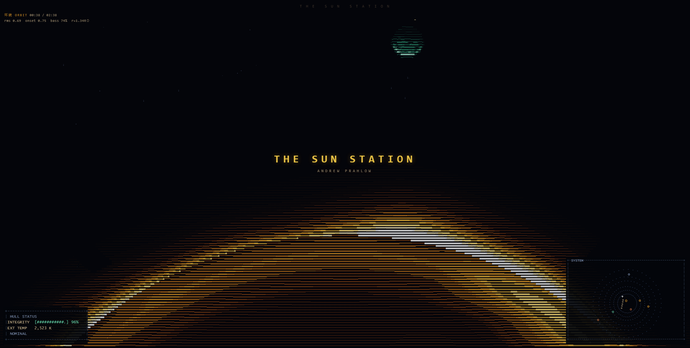

# The Sun Station — 舷窗 ASCII

把 Andrew Prahlow《The Sun Station》（游戏《星际拓荒》Outer Wilds 原声）的**频谱与节奏特征**实时驱动成一段
**第一人称舷窗视角的 ASCII 数字艺术**：飞船在太空中航行、变轨入轨、贴近恒星光球层环绕、观察行星运转，
恒星剧烈翻滚膨胀，最终坠入恒星。



## 它是什么

一个**自包含单文件网页**：音频、特征数据全部内联，双击即可在本地浏览器打开（`file://`，无需服务器）。
画面全部由字符网格（Canvas 逐格绘制等宽字形）构成；相机是真正的 3D 相机，恒星、行星、星场通过透视投影得到，
景深与遮挡按几何计算。

### 六段场景（与曲目时间轴对齐）

| 时间 | 场景 |
|---|---|
| 00:00 | 太空中航行，远方恒星渐近 |
| 00:10 | 变轨，向恒星俯冲 |
| 00:16 | 贴近光球层，沿弧形临边环绕 |
| 00:25 | 环绕观测：其它行星在星空中运转、恒星半弧；标题浮现 |
| 01:48 | 恒星表面剧烈翻滚并开始膨胀 |
| 02:15 | 主视角坠入恒星 |

> 场景时间线依据音频能量包络确定：01:48 起高频段抬升（表面翻滚），02:15 为全曲最大能量峰（坠入）。

## 技术方法

参考 [grey-cloud-ascii](https://github.com/ScreamingMaggot/grey-cloud-ascii) 的思路：**形状来自曲子本身**。

1. **特征提取**（`tools/features.py`，librosa）：逐帧 28 段对数频带能量、RMS、谱通量、谱质心、
   低高频比、拍点脉冲，烘焙为 `tools/features.json`。
2. **3D 星系模型**：恒星在原点、行星在倾斜轨道上按曲速公转、相机沿轨道运行并坠入。
   屏幕像素 → 世界射线 → 与恒星/行星球面求交，得到真实的**逐像素深度遮挡**与光球层纹理（种子取自球面命中点，故随公转平移）。
3. **特征驱动映射**：频段→纵向、振幅→字形密度、能量/谱平衡→明暗与呼吸、
   脉动→星空超新星、结构损坏度→HUD 乱码与淡出。
4. **确定性渲染**：任一时刻 `t` 的画面由 `t` 唯一决定（无随机状态），因此可复现、可离线逐帧导出。

### 可证伪的“特征驱动”

- 打乱时间轴后重渲，像素网格 MSE 显著 > 0（画面确实随特征变化，而非写死的动画）。
- 把全部帧替换为“静音帧” vs “高潮帧”，整体亮度随特征明显变化。

（验证脚本：`tools/verify.mjs`。）

## 运行 / 构建

需要 Python（librosa、numpy、scipy、soundfile）与 ffmpeg。

本仓库**不包含音乐与成片**（版权原因）。请自备曲目并放置为：

```
The Sun Station - Andrew Prahlow.mp3
```

然后：

```bash
python tools/features.py     # 提取特征 -> tools/features.json
python tools/build.py        # 注入音频与特征 -> 太阳站-ASCII舷窗.html
```

用浏览器打开生成的 `太阳站-ASCII舷窗.html`，点击进入即可。

### 交互与参数

- 点击 “CLICK TO ENTER” 开始（音频自动播放，若无音频则用确定性时钟兜底）。
- `?fs=7.3` 可指定字符密度（数值越小字符越小、网格越密，默认 11）。
- 右上角 `● REC` 可实时录制画面与音频，导出 `.webm`。

### 离线导出成片（可选）

`tools/export.mjs` 用 CDP 驱动无头 Edge 逐帧渲染（`Page.captureScreenshot`，PNG 无损），
再由 ffmpeg 用原始音轨封装为 mp4（同时产出 yuv420p 通用版与 yuv444p 保色版）。
`tools/cover.mjs` 用于抓取封面静帧。

## 文件

```
太阳站-ASCII舷窗.html     构建产物（自包含、内嵌音频；由 build.py 生成，未纳入版本库）
任务.txt                  创作要求
cover_*.png               封面/静帧
tools/features.py         频谱/节奏特征提取
tools/features.json       烘焙后的逐帧特征
tools/template.html       渲染器源码（3D 相机 / 投影 / 着色 / HUD）
tools/build.py            注入音频与特征，产出单文件 HTML
tools/verify.mjs          离线验证：连续性、特征驱动证伪、运动量
tools/export.mjs          离线逐帧导出成片
tools/cover.mjs           封面抓取
```

## 致谢与声明

- 音乐：**The Sun Station** — Andrew Prahlow，《Outer Wilds》原声（© Mobius Digital / Annapurna Interactive）。
  本仓库不包含该曲目，亦不用于商业用途；请支持正版。
- 方法参考：[grey-cloud-ascii](https://github.com/ScreamingMaggot/grey-cloud-ascii)。
